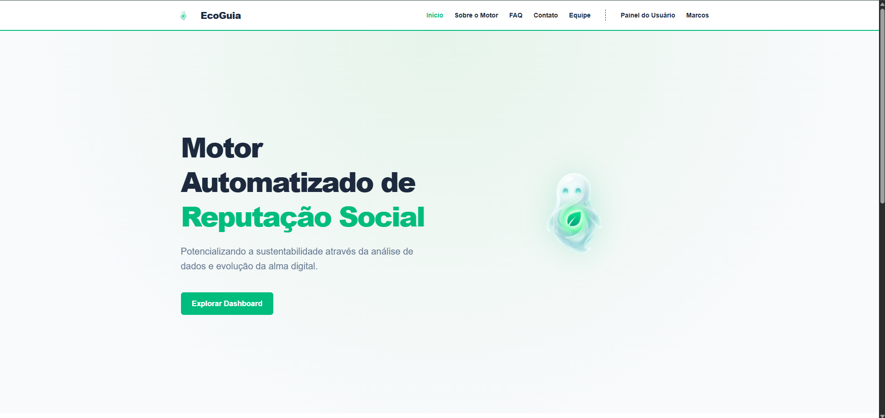
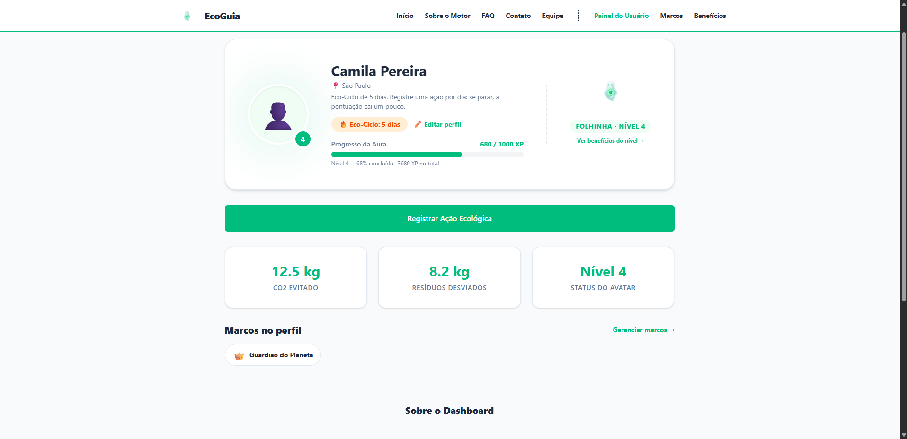
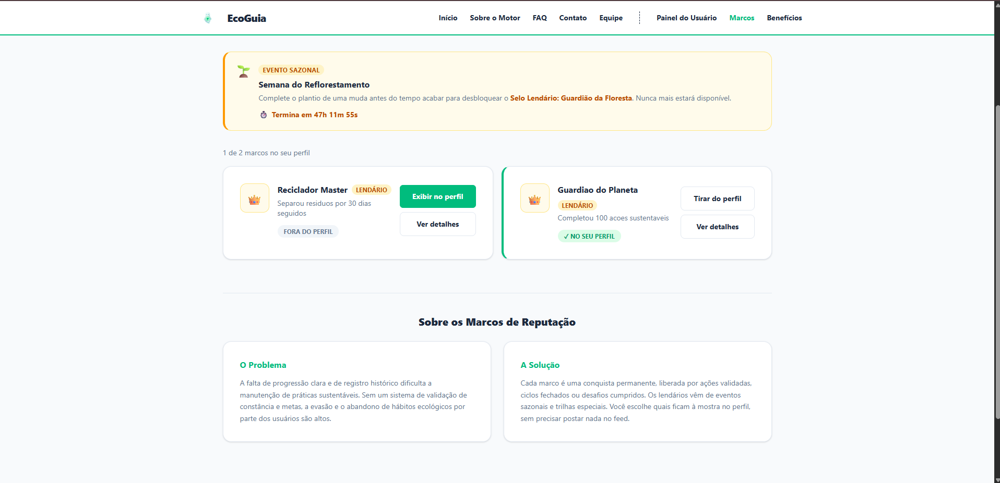

# EcoGuia - Motor de Reputação SoulUp

O **EcoGuia** é uma aplicação Single Page Application (SPA) que centraliza e comprova o histórico de ações ecológicas dos usuários através de um **Motor de Reputação Social** gamificado, a *Aura Digital*. Esta entrega representa a **SPRINT 04 - Front-End Design Engineering**: o site agora consome a API REST desenvolvida em Java pelo grupo.

## 🛠️ Tecnologias Utilizadas

- **React 19** (Interface e Componentização)
- **Vite** (Ferramenta de Build)
- **TypeScript** (Tipagem estática, incluindo as respostas da API)
- **Tailwind CSS v4** (Estilização responsiva)
- **React Router DOM** (Rotas estáticas, rota dinâmica e página 404)
- **React Hook Form** (Formulários com validação)
- **Fetch API** (Requisições HTTP para a API Java)
- **Vercel** (Deploy da aplicação)

## 🔌 Integração com a API Java

Todas as chamadas ficam na pasta `src/services`, uma por recurso da API. O projeto não tem login: o site usa o usuário de id 1 cadastrado no banco (constante `USUARIO_ID` em `src/services/api.ts`).

| Tela | Requisições | O que o usuário faz |
| :--- | :--- | :--- |
| Painel do Usuário | `GET /usuarios/1`, `GET /avatares/{id}`, `GET /badges`, `GET /conquistas` | Vê nome, cidade, ofensiva, nível, XP e os marcos do perfil |
| Painel: Registrar ação | `PUT /avatares/{id}`, `PUT /usuarios/1` | Escolhe uma ação, o XP é somado e a API recalcula o nível. A primeira ação do dia soma +1 no Eco-Ciclo |
| Marcos | `GET /badges`, `GET /conquistas` | Vê todos os marcos e quais estão no perfil |
| Marcos: exibir / tirar do perfil | `POST /conquistas`, `DELETE /conquistas/{id}` | Coloca ou tira um marco do perfil |
| Detalhe do marco (`/marcos/:id`) | `GET /badges/{id}` | Vê o marco. Se o id não existir, volta para a lista |
| Editar perfil | `PUT /usuarios/1` | Altera nome, e-mail e cidade |
| Benefícios | `GET /avatares/{id}` (via contexto) | Vê os benefícios do Eco-Ciclo liberados pelo nível do avatar |

Toda tela que usa a API mostra mensagem de carregamento, de erro (com botão para tentar de novo) e de lista vazia.

> A API está no plano gratuito do Render, que desliga o servidor quando fica parado. Por isso a primeira carga pode levar até 1 minuto. Depois disso as telas carregam normalmente.

## 📁 Estrutura de Pastas do Projeto

```text
📦 ecoguia
 ┣ 📂 public                # Assets estáticos (favicon)
 ┣ 📂 src
 ┃ ┣ 📂 assets              # Imagens (alma.png, fotos do time, prints)
 ┃ ┣ 📂 components          # Componentes reutilizáveis (Header, Footer, Button, Card, StatusMensagem...)
 ┃ ┣ 📂 context             # Contexto do usuário (UserContext.ts e UserProvider.tsx)
 ┃ ┣ 📂 pages               # Páginas da SPA (Home, Sobre, FAQ, Contato, Integrantes, Dashboard, Marcos, MarcoDetalhe, Beneficios, EditarPerfil, NaoEncontrada)
 ┃ ┣ 📂 routes              # Rotas da aplicação (AppRoutes.tsx)
 ┃ ┣ 📂 services            # Chamadas à API Java (api.ts, usuarioService, avatarService, badgeService, conquistaService)
 ┃ ┣ 📂 types               # Interfaces e tipos globais (index.ts)
 ┃ ┣ 📂 utils               # Funções auxiliares (marcos.ts)
 ┃ ┣ 📜 App.tsx             # Componente raiz
 ┃ ┣ 📜 index.css           # Estilização global mínima
 ┃ ┗ 📜 main.tsx            # Ponto de entrada da aplicação
 ┣ 📜 package.json          # Dependências e scripts
 ┣ 📜 tsconfig.json         # Configuração do TypeScript
 ┣ 📜 vercel.json           # Redirecionamento das rotas da SPA na Vercel
 ┗ 📜 vite.config.ts        # Configuração do Vite
```

## ▶️ Como rodar o projeto

```bash
cd ecoguia
npm install
npm run dev
```

O endereço da API fica na constante `API_URL`, em `src/services/api.ts` (https://ecoguia-api-rest.onrender.com).

## 👨‍💻 Autores e Créditos

Equipe responsável pelo desenvolvimento do EcoGuia:

| Foto | Nome / RM / Turma | GitHub | LinkedIn |
| :---: | :--- | :--- | :--- |
|  | **Ana Paula Cunha Brum**<br>RM: 571359<br>Turma: 1º TDSR | [abbrum](https://github.com/abbrum) | [LinkedIn](https://www.linkedin.com/in/ana-paula-brum/) |
|  | **Gabriella Serni Ponzetta**<br>RM: 566296<br>Turma: 1º TDSR | [gabriellaserni](https://github.com/gabriellaserni) | [LinkedIn](https://www.linkedin.com/in/gabriellaserni/) |
|  | **Victor Felipe Silva Alencar**<br>RM: 574057<br>Turma: 1º TDSR | [alencarVictor](https://github.com/alencarVictor) | [LinkedIn](https://www.linkedin.com/in/victor-alencar-58623a3ba/) |
|  | **Julio Cesar Iwata de Oliveira Barros**<br>RM: 573723<br>Turma: 1º TDSR | [IwaataNz3](https://github.com/IwaataNz3) | [LinkedIn](https://www.linkedin.com/in/julioiwata/) |
|  | **Rafael Santos Dias**<br>RM: 574105<br>Turma: 1º TDSR | [realrafaelsd](https://github.com/realrafaelsd) | [LinkedIn](https://www.linkedin.com/in/rafaelsd/) |

## 🖼️ Imagens e Ícones do Projeto

Abaixo estão algumas demonstrações visuais da nossa aplicação:

### Alma Digital

*O avatar que evolui de acordo com suas ações ecológicas validadas pelo motor.*

### Screenshots

**Página Inicial (Home)**


**Painel do Usuário (Dashboard)**


**Trilha de Marcos**


## 🔗 Como Usar (Links Úteis)

- **Repositório do GitHub:** https://github.com/IwaataNz3/Ecoguia-React-FIAP
- **Deploy na Vercel:** (a definir)
- **API Java publicada:** https://ecoguia-api-rest.onrender.com
- **Repositório da API Java:** https://github.com/alencarVictor/ecoguia-API-REST
- **Vídeo de apresentação da Sprint 4 (YouTube):** (a definir)

## ✉️ Contato

Caso tenha dúvidas sobre o projeto ou a arquitetura proposta:
- **E-mail Geral:** rm573723@fiap.com.br
- **Suporte Técnico:** rm574057@fiap.com.br
